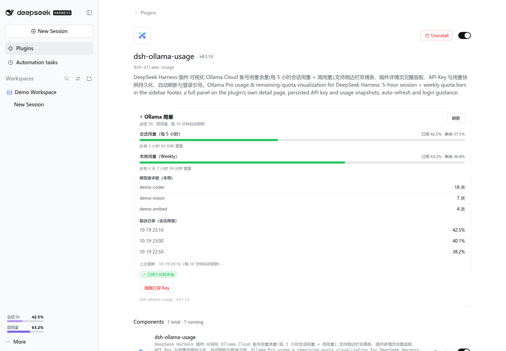
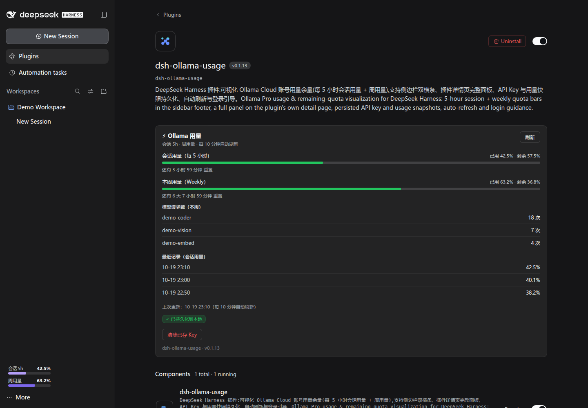
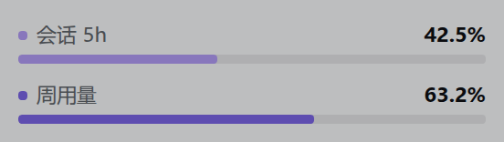

<div align="center">

# ⚡ dsh-ollama-usage

**Ollama Cloud 用量余量可视化 · DeepSeek Harness 插件**

[](https://www.npmjs.com/package/dsh-ollama-usage)
[](https://www.npmjs.com/package/dsh-ollama-usage)
[](LICENSE)
[](package.json)
[](https://github.com/SeverusZh/dsh-ollama-usage/releases)
[](https://github.com/SeverusZh/dsh-ollama-usage)
[](https://github.com/deepseek-ai/deepseek-harness)
[](https://awesome-dsh-plugin.com)

</div>

可视化你的 **Ollama Cloud** 用量余量 —— 每 5 小时会话用量 + 周用量，
侧边栏极简双横条常驻显示，插件详情页完整面板，Key 与快照持久化，自动刷新。

*Ollama Cloud usage & remaining-quota visualization for DeepSeek Harness —
5-hour session + weekly quota, always-visible sidebar bars, a full panel on the
plugin's own detail page, persisted credentials & snapshots, auto-refresh.*

---

## ✨ 功能特性 / Features

| 能力 | 说明 |
| --- | --- |
| 🎯 **会话用量（每 5 小时）** | Ollama Cloud 的 5 小时会话配额，置顶展示「已用 X% · 剩余 Y%」 |
| 📅 **周用量（Weekly）** | 本周配额进度，与会话用量并排展示 |
| 🎨 **侧边栏双横条** | 极简透明风格：会话 5h **淡紫** + 周用量**深紫**，各带百分比数字，悬停显示详情，每 60 秒自动更新（窄栏自动隐藏） |
| 🖥️ **插件详情页完整面板** | 渲染在「插件列表 → dsh-ollama-usage」页面的描述与组件行之间：会话/周用量进度条、会话与周重置倒计时、最近 5 条会话用量历史；卡片化分区，带加载 / 错误 / 成功状态提示 |
| 💾 **持久化** | API Key 与用量快照写入 `$DSH_HOME/storages/ollama-usage/usage.json`（权限 600，保留 24 条历史），跨对话 / 重启自动恢复 |
| 🔄 **自动刷新** | Host 每 10 分钟自动查询（页面关闭也持续）；Key 失效（401）自动清除并提示 |
| 🔑 **登录引导** | 未登录时一键打开 [ollama.com/settings](https://ollama.com/settings) 登录、到 [settings/keys](https://ollama.com/settings/keys) 创建 API Key；兼容旧版 CLI 的 `~/.ollama/auth.json` |

限额进度数据来源于 Ollama 官方接口 `GET https://ollama.com/api/balance`
（`included.session` / `included.weekly` 的 `remaining_percent` 与 `resets_at`），
与 [ollama.com/settings](https://ollama.com/settings) 页面一致。

> **v0.1.11 修复**：Ollama 在 2026-10 把 `GET /api/usage` 改为只返回按小时/天的
> 请求量分桶，不再包含 `limits.session` / `limits.weekly`，旧版本因此把两个百分比
> 解析成 `null` —— 面板显示「暂无数据」、侧边栏双横条显示「—」。
> 现在限额进度改由 `/api/balance` 提供（`已用 = 100 - remaining_percent`），
> 重置倒计时也直接使用接口下发的真实 `resets_at`。

## 📦 安装 / Install

```bash
dsh plugin --profile web add dsh-ollama-usage
dsh --profile web
```

> 也可手动把 `dsh-ollama-usage` 加入 profile `package.json` 的
> `dsh.profile.bundles` 后重启。

## 🚀 使用 / Usage

1. 打开 **插件列表 → dsh-ollama-usage**（面板渲染在该页面的描述与组件行之间）；
2. 未登录时按面板指引：登录 [ollama.com](https://ollama.com/settings) →
   [settings/keys](https://ollama.com/settings/keys) 创建 API Key →
   粘贴并点 **检测**（或终端 `ollama signin` 后点 **重新检测本地凭证**）；
3. 检测成功后即持久化，展开侧边栏即可看到底部双横条，面板可随时查看详情与历史；
4. 不再需要时点 **清除已存 Key** 移除本地凭证（历史保留）。

## 🖼️ 界面预览 / Screenshots

以下截图来自本地一次性预览实例，示例数据仅用于演示：







## 🔒 数据与隐私 / Privacy

- 仅向 `https://ollama.com/api/balance` 发送带 Bearer 的查询请求；
- Key 以明文保存在本机 `$DSH_HOME/storages/ollama-usage/usage.json`（权限 600，
  与 `~/.ollama/auth.json` 同等级信任），随时可清除。

## 🏗️ 架构 / Architecture

```
┌──────────────────────────┐        ┌─────────────────────────────┐
│  browser (client bundle) │  RPC   │  host (lib/index.js)        │
│  lib/client.js           │◄──────►│  webServer /ollama-usage    │
│  · sidebar dual bars     │ 信封协议 │  · fetch api/balance(Bearer)│
│  · settings panel        │        │  · $DSH_HOME 持久化(0600)   │
│  · login guidance        │        │  · 10min auto-refresh       │
└──────────────────────────┘        └─────────────────────────────┘
```

- 宿主入口 `lib/index.js`：ESM，导出 `name` + 默认插件；`webServer` 前缀路由 +
  Connection RPC 信封协议（`check` / `snapshot` / `forget` / `auth-state`）。
- 客户端入口 `lib/client.js`：`window.__ModuleLoader__.load` bundle，经
  `connection.rpc.call('/ollama-usage', endpoint, payload)` 与宿主通信。
- 接线：`cordis.patch.yml`（Loader 行）+ `package.json` 的
  `dsh.bundle.patch` / `dsh.client` 声明。

## 🧩 兼容性 / Compatibility

DSH 0.2.1 起兼容门禁优先读取 `engines.dsh`。本插件声明 **`engines.dsh: ">=0.1.7-rc.1"`**（无上限），`@deepseek-ai/dsh-home-paths` peer 保持 `>=0.1.7-rc.1`，并已核对：

| DSH 版本 | 状态 |
| --- | --- |
| 0.1.5-rc.1 | ✅ 实测通过 |
| 0.1.5-rc.2 | ✅ 实测通过 |
| 0.1.6-alpha.2 | ✅ 实测通过 |
| 0.1.7-rc.1 | ✅ 实测通过 |
| 0.1.7-rc.2 | ✅ 实测通过 |
| 0.2.0-rc.1 | ✅ 实测通过 |
| 0.2.1-rc.1 | ✅ 兼容门禁 + 探针通过 |
| 0.2.1-rc.2 | ✅ 兼容门禁通过 |

> 只列出**实际跑过**的版本；未实测的不列。

v0.1.16 支持 DSH **≥0.1.5-rc.1**（`@deepseek-ai/dsh-*` peer 放宽为 `>=0.1.7-rc.1`），已在 **0.1.5-rc.1 / 0.1.5-rc.2 / 0.1.6-alpha.2 / 0.1.7-rc.1 / 0.1.7-rc.2 / 0.2.0-rc.1** 实测（RPC envelope 探针全过；0.1.7-rc.2 上 `/ollama-usage/snapshot` 实测返回；0.2.0-rc.1 上通过新的兼容性门禁并正常加载；0.2.1-rc.1 上兼容门禁与 RPC envelope 探针通过，0.2.1-rc.2 门禁通过）；旧版 DSH（0.1.0-rc.5 ~ rc.8）请使用最后兼容的 npm 版本 **0.1.5**。

## 🛠️ 开发 / Develop

### 测试 / Tests

```bash
npm test   # bridge-smoke → balance-parse → rpc-envelope-alpha4
```

- `test/bridge-smoke.mjs`（17 项）：路由注册、no-token / 401 分支、持久化读写与
  清理、snapshot / forget / auth-state、非法信封与请求方法校验。
- `test/balance-parse.mjs`：`/api/balance` 解析回归（不联网，fetch 替身）。用真实
  响应体驱动 `check`，断言 5h / 周百分比换算、`resets_at` 透传、持久化与历史追加，
  以及无限额套餐 / 非 JSON / 401 / 403 / 网络异常各分支。
- `test/rpc-envelope-alpha4.mjs`：逐端点通过 alpha.4 的 Connection RPC 信封校验器。

### 构建与发布 / Build & Publish

```bash
npm install                 # 安装依赖(@deepseek-ai/dsh-home-paths)
npm test                    # 冒烟测试(见上)
npm pack                    # 本地打包检查
npm publish                 # 发布到 npm
```

## 📄 许可证 / License

[MIT](LICENSE) © 2026 dsh-ollama-usage contributors
